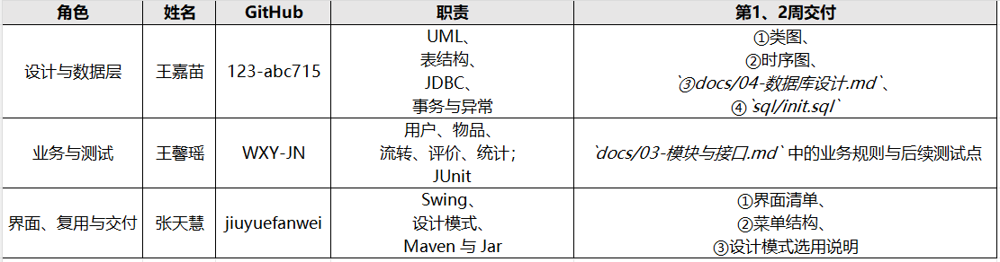

# 小组分工

| 角色 | 姓名 | GitHub | 贯穿职责 | 第 1/2 周交付 |
| --- | --- | --- | --- | --- |
| 设计与数据层 |  |  | UML、表结构、JDBC、事务与异常 | 类图、时序图、`docs/04-数据库设计.md`、`sql/init.sql` |
| 业务与测试 |  |  | 用户、物品、流转、评价、统计；JUnit | `docs/03-模块与接口.md` 中的业务规则与后续测试点 |
| 界面、复用与交付 | 张天慧 |  | Swing、设计模式、Maven 与 Jar | 界面清单、菜单结构、设计模式选用说明，见 `docs/05-界面与设计模式.md` |

约束：三人都要写代码和测试，不能只做文档。每周至少一次讨论，记录放在 `docs/meetings/`。
